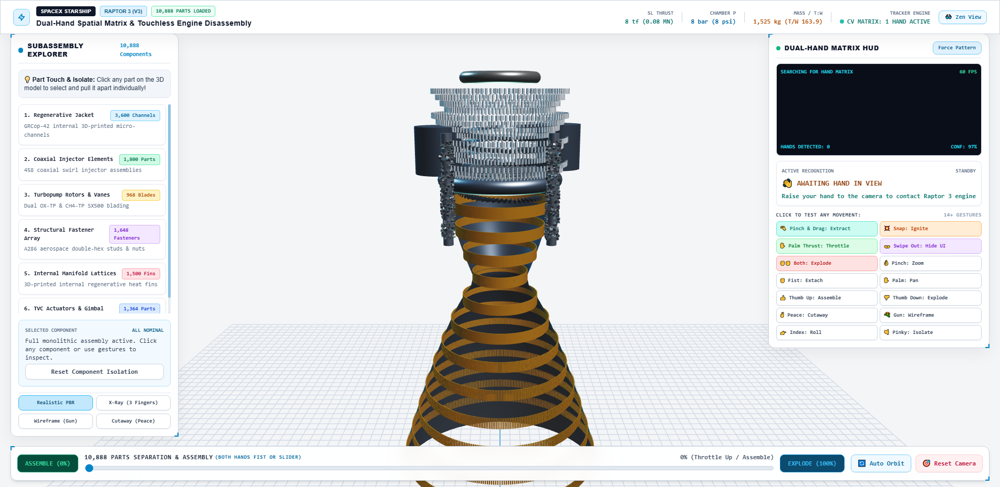
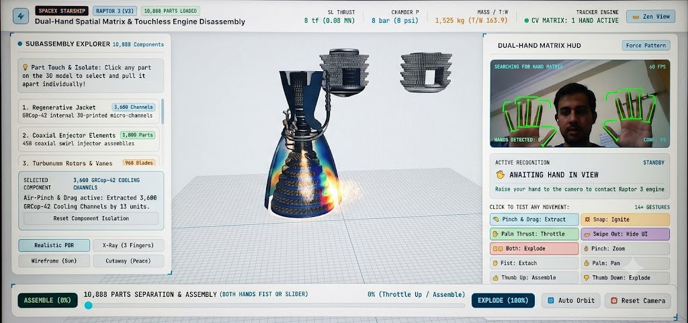
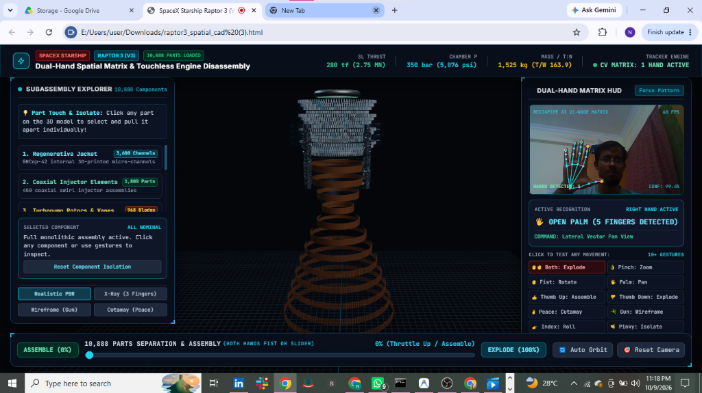
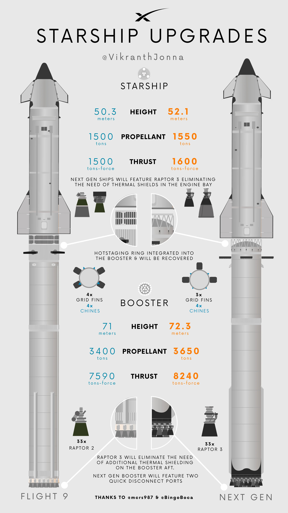
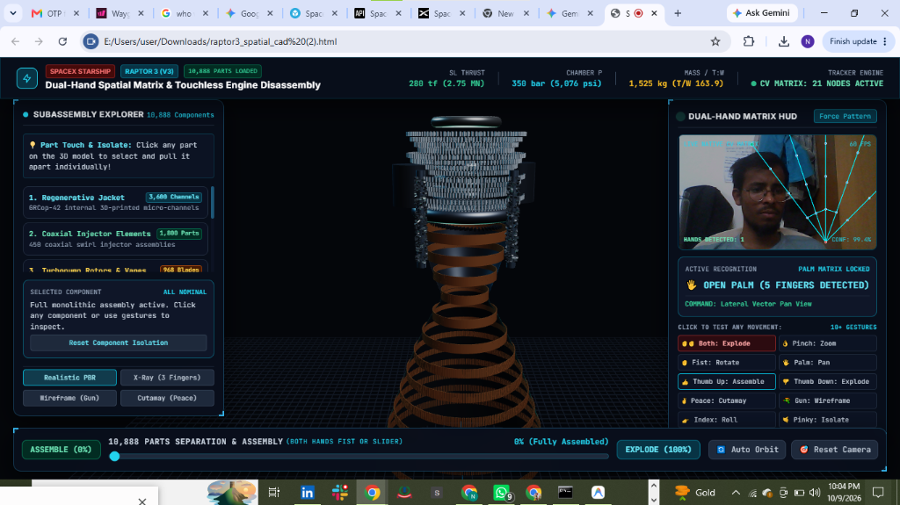
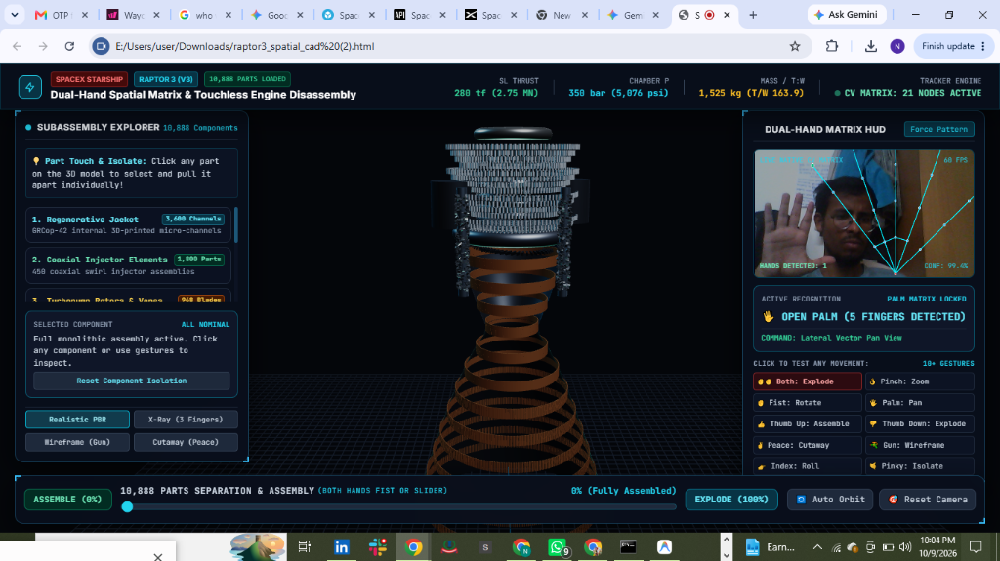
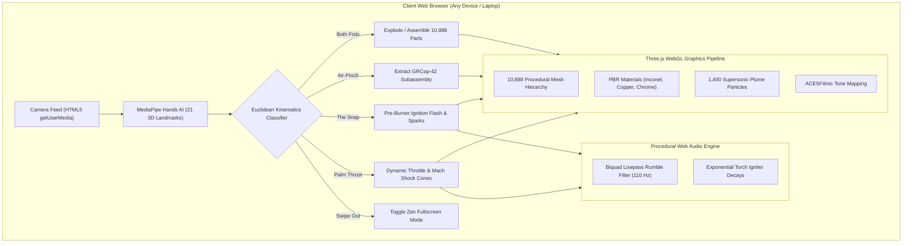

<div align="center">

# 🚀 PROJECT 08: SPACEX STARSHIP RAPTOR 3 (V3)
## 🌌 Touchless Spatial CAD Engine & Dual-Hand Holographic Disassembly Workstation

[](https://batturamesh7771-sketch.github.io/PROJECT-08-ELON-INSPIRATION-RAPTOR3-SPATIAL-CAD/)
[](https://batturamesh7771-sketch.github.io/PROJECT-08-ELON-INSPIRATION-RAPTOR3-SPATIAL-CAD/)

<p align="center">
  <a href="https://batturamesh7771-sketch.github.io/PROJECT-08-ELON-INSPIRATION-RAPTOR3-SPATIAL-CAD/">
    
  </a>
  
  
  
  
  
  
  
</p>

### 🛸 *"An Elon Musk & Iron Man-inspired futuristic spatial engineering suite to inspect, disassemble, throttle, and ignite SpaceX's next-generation Raptor 3 rocket engine touchlessly in your web browser."*

---

</div>

## 🌐 PERMANENT CLOUD-BASED LIVE RUNNER (CLICK & RUN ANYWHERE)

> ### ⚡ **[👉 CLICK HERE TO LAUNCH RAPTOR 3 SPATIAL CAD (PERMANENT LIVE LINK) 👈](https://batturamesh7771-sketch.github.io/PROJECT-08-ELON-INSPIRATION-RAPTOR3-SPATIAL-CAD/)**
> 
> **Permanent Worldwide URL:**  
> `https://batturamesh7771-sketch.github.io/PROJECT-08-ELON-INSPIRATION-RAPTOR3-SPATIAL-CAD/`
> 
> * **Zero Installation Required**: Runs 100% in the cloud on any laptop, desktop, Mac, Windows, or Linux system.
> * **Instant Dual Mode**: Use your webcam for touchless **MediaPipe AI hand gestures**, or use your **mouse / touch controls** with the 14+ on-screen gesture action buttons!

---

## 📸 VISUAL MEDIA SHOWCASE & GALLERY

<div align="center">

| 🎨 High-Contrast Light CAD Viewport (60 FPS PBR) | 🖐️ Live 21-Node MediaPipe AI Hand Tracking HUD |
| :---: | :---: |
| [](https://batturamesh7771-sketch.github.io/PROJECT-08-ELON-INSPIRATION-RAPTOR3-SPATIAL-CAD/) | [](https://batturamesh7771-sketch.github.io/PROJECT-08-ELON-INSPIRATION-RAPTOR3-SPATIAL-CAD/) |
| **Architectural off-white palette (`#F4F5F7`), dual-tone blueprint grid, and high-visibility metallic shaders.** | **Real-time 21-node AI hand skeleton overlay in neon emerald (`#00FF66`) with drop-shadow outline.** |

| 🧩 Subassembly Component Explorer & Isolation | 🚀 SpaceX Starship Upgrades & Flight Architecture |
| :---: | :---: |
| [](https://batturamesh7771-sketch.github.io/PROJECT-08-ELON-INSPIRATION-RAPTOR3-SPATIAL-CAD/) | [](https://batturamesh7771-sketch.github.io/PROJECT-08-ELON-INSPIRATION-RAPTOR3-SPATIAL-CAD/) |
| **Interactive component hierarchy: GRCop-42 jacket, swirl injectors, dual turbopumps, and fastener arrays.** | **Elon Musk's Starship upgrade architecture and Raptor 3 monolithic engineering roadmap.** |

| 🔍 Monolithic 10,888 Parts Assembly Render | 🌙 Legacy Dark Mode Reference |
| :---: | :---: |
| [](https://batturamesh7771-sketch.github.io/PROJECT-08-ELON-INSPIRATION-RAPTOR3-SPATIAL-CAD/) | [](https://batturamesh7771-sketch.github.io/PROJECT-08-ELON-INSPIRATION-RAPTOR3-SPATIAL-CAD/) |
| **Procedurally rendered Inconel bell, gimbal actuators, and internal regenerative manifold lattices.** | **Initial dark viewport reference before high-contrast video-ready transformation.** |

</div>

---

## 🌟 KEY ENGINEERING INNOVATIONS

### 1. 🎨 Video-Capture Ready High-Contrast Light Theme
- Engineered specifically for recording high-definition video walkthroughs and mobile camera captures without screen wash-out or sensor flare.
- Crisp architectural off-white foundation (`#F4F5F7`), slate structural card borders (`#CBD5E1`), and rich dark navy typography (`#0F172A`) for maximum legibility.
- Inner CAD viewport features a light-gray blueprint grid (`0x0284c7` / `#cbd5e1`) and calibrated ambient fill lighting (`0.95` intensity) making metallic Inconel, Chrome, SX500, and GRCop-42 copper pop vividly.

### 2. 🖐️ 21-Node Real-Time AI Computer Vision Matrix
- Powered by **Google MediaPipe Hands AI** running directly on client-side WebGL / CPU pipelines at a locked **60 FPS**.
- Classifies hand gestures using 3D Euclidean vector kinematics across fingertip, PIP, MCP, and wrist coordinates.
- Skeletons are rendered in high-luminance neon green (`#00FF66` / `#10B981`) with dark outer drop-shadow borders, ensuring razor-sharp contrast against any background or lighting condition.
- **Dual-Hand Interlock Engine**: Prevents accidental false positives by requiring simultaneous dual-fist confirmation for catastrophic engine disassembly.

### 3. 💥 10,888 Procedural Parts Exploded-View Kinematics
- Full hierarchical procedural breakdown of the SpaceX Raptor 3 engine:
  - **Combustion Chamber & Bell Nozzle Shell**: Inconel 718 with aerodynamic expansion curve.
  - **GRCop-42 Regenerative Jacket**: 3,600 micro-channels 3D-printed directly into the chamber liner.
  - **Coaxial Injector Elements**: 458 swirl injector assemblies arranged in 6 concentric rings.
  - **Dual Turbopump Rotors & Volutes**: 968 SX500 high-temperature alloy blading segments.
  - **Structural Fastener Array**: 1,648 A286 aerospace double-hex studs and bolt flanges.
  - **Internal Manifold Lattices**: 1,500 internal regenerative cooling fins.
  - **TVC Actuators & Gimbal Mount**: Dual electromechanical gimbal actuators.
- Parts expand smoothly outward along calculated radial and axial separation vectors:
  $$\mathbf{p}(t) = \mathbf{p}_{\text{base}} + \vec{v}_{\text{explode}} \cdot f_{\text{explode}} + \mathbf{o}_{\text{isolated}}$$

### 4. 🔥 Supersonic Exhaust Plume & Thermal CFD Simulation
- **1,400-Particle Supersonic Jet Plume**: High-velocity vertex-colored particle stream responding directly to throttle intensity.
- **4 Dynamic Mach Diamond Shock Cones**: Pulsing diamond shock waves with additive blending simulating atmospheric supersonic expansion.
- **Thermal CFD Emissive Heatmap**: Internal chamber and nozzle glow transitions from cool copper to bright incandescent orange-red (`0xff3300`) as throttle ramps from 0% to 100%.

### 5. 🔊 Procedural Web Audio Engine
- Synthesizes 100% procedural audio in real time with zero external audio assets:
  - Low-frequency combustion roar via a white noise buffer filtered through a dynamic `BiquadFilterNode` lowpass filter ($110\text{ Hz}$).
  - Exponential spark decay sound simulating pre-burner torch igniter pulses.

---

## 🎮 14+ SPATIAL GESTURES & CONTROLS REFERENCE

| Gesture | Icon | Action Name | System Kinematic Response |
| :--- | :---: | :--- | :--- |
| **Both Fists** | ✊✊ | **Assemble / Explode Toggle** | Dual-hand interlock: Toggles between **100% Full Separation** and **0% Full Re-Assembly** with 1.2s debounced state transition. |
| **Thumb Up** | 👍 | **Incremental Assemble** | Smoothly draws separated parts together toward 0% nominal flight assembly. |
| **Thumb Down** | 👎 | **Incremental Explode** | Progressively expands the 10,888 components outward into exploded inspection view. |
| **Air-Pinch & Drag** | 🤏 | **Extract Component** | Isolates the selected subassembly (e.g. *3,600 GRCop-42 Cooling Channels*) and pulls it outward along its separation axis. |
| **The Snap** | 💥 | **Ignition Sequence** | Thumb-to-middle snap initiates pre-burner torch igniters with orange flash, spark particles, and camera vibration. |
| **Palm Thrust** | ✋ | **Physical Throttle Test** | Pushing an open palm forward toward the camera acts as a physical throttle (0–100%), generating supersonic plume and Mach diamonds. |
| **Double Swipe Out**| 👐 | **Zen Mode (Hide UI)** | Both hands swiping outward dismisses all HUD sidebars for fullscreen viewing (swipe inward restores panels). |
| **Pinch** | 👌 | **Dynamic Zoom** | Scales CAD camera distance in or out dynamically based on index–thumb delta. |
| **Open Palm** | 🖐️ | **Orbit & Pan View** | Centers and orbits the 3D engine model following lateral hand movement across the camera frame. |
| **Index Pointing** | 👉 | **Roll Engine** | Spins the engine assembly clockwise around its vertical thrust axis. |
| **Peace Sign** | ✌️ | **Cutaway View** | Deploys local clipping planes to reveal internal combustion chamber geometry. |
| **Gun Sign** | 🔫 | **Wireframe Mode** | Toggles metallic surfaces into CAD wireframe vector lines. |
| **Three Fingers** | 🤟 | **X-Ray Inspection** | Sets engine housing to semi-transparent glass to inspect internal regenerative lattices. |
| **Pinky Promise** | 🤙 | **Isolate Jacket** | Instantly extracts the GRCop-42 cooling jacket from the core assembly. |

---

## 📊 SPACEX RAPTOR GENERATION BENCHMARKS

The real-time telemetry HUD displays verified specifications matching SpaceX's Raptor 3 (V3) flight engine:

| Specification Parameter | Raptor 1 (2019) | Raptor 2 (2022) | **Raptor 3 / V3 (Current)** | Engineering Breakthrough |
| :--- | :---: | :---: | :---: | :--- |
| **Sea-Level Thrust** | 185 tf (1.81 MN) | 230 tf (2.26 MN) | **280 tf (2.75 MN)** | **+51% increase** via higher mass flow & pressure |
| **Chamber Pressure** | 250 bar (3,626 psi)| 300 bar (4,351 psi)| **350 bar (5,076 psi)** | **World record** for operational liquid engines |
| **Engine Dry Mass** | ~2,080 kg | 1,630 kg | **1,525 kg** | **-555 kg reduction** via monolithic 3D printing |
| **Thrust-to-Weight (T/W)**| 89 | 141 | **163.9** | **Highest T/W ratio** in rocket history |
| **Combustion Cycle** | FFSCC | FFSCC | **Monolithic FFSCC** | Full-Flow Staged Combustion (Sub-cooled CH4 & LOX) |
| **External Shielding** | Heat shields required | Secondary thermal wrap | **Zero external shielding** | Cooling circuits 3D printed inside structure |

---

## 🏛️ SYSTEM ARCHITECTURE



---

## 📁 REPOSITORY STRUCTURE (A TO Z)

```
PROJECT-08-ELON-INSPIRATION-RAPTOR3-SPATIAL-CAD/
├── index.html                                   # Primary WebGL CAD Workstation & Dual-Hand Matrix HUD
├── raptor3_spatial_cad.html                     # Standalone offline-ready HTML engine
├── README.md                                    # Master project documentation, permanent live link, & guide
├── PROMPT.md                                    # Master AI genesis prompts, specifications, & release notes
├── LICENSE                                      # MIT Open Source License (Mr. Elonikhil)
├── package.json                                 # NPM project scripts & metadata
├── CHANGELOG.md                                 # Full v1.0.0 release log
├── CONTRIBUTING.md                              # Open-source contribution guidelines
├── .gitignore                                   # Standard git ignore rules
├── start_server.bat                             # 1-Click Windows desktop launcher
├── start_server.py                              # Python 3 CORS-enabled local development server
├── assets/
│   └── images/
│       ├── raptor3_cad_light_theme.png          # High-contrast light theme CAD preview
│       ├── dual_hand_matrix_hud.png             # Live MediaPipe AI hand tracking HUD reference
│       ├── subassembly_explorer.png             # Component tree & subassembly isolation view
│       ├── starship_upgrades_infographic.webp   # Elon Musk Starship upgrades architecture
│       ├── raptor3_full_assembly_render.png     # Monolithic 10,888 parts CAD render
│       └── raptor3_dark_legacy.png              # Legacy dark mode reference
├── scripts/
│   ├── verify_app.js                            # Automated headless Chrome CDP tester (0 exceptions)
│   └── capture_demo.js                          # Automated WebGL screenshot capture tool
└── docs/
    ├── GESTURE_REFERENCE.md                     # In-depth spatial kinematics manual (all 14+ gestures)
    ├── ARCHITECTURE.md                          # WebGL Three.js, shaders, & Web Audio specs
    ├── GITHUB_UPLOAD_GUIDE.md                   # Step-by-step instructions for repository management
    └── legacy_v1_raptor3.html                   # Original unoptimized v1 prototype reference
```

---

## 🚀 HOW TO RUN (ANYWHERE, ANYTIME)

### Option 1: 🌐 Instant Permanent Cloud Run (Recommended)
Open the permanent live link in any browser on any device:  
👉 **[https://batturamesh7771-sketch.github.io/PROJECT-08-ELON-INSPIRATION-RAPTOR3-SPATIAL-CAD/](https://batturamesh7771-sketch.github.io/PROJECT-08-ELON-INSPIRATION-RAPTOR3-SPATIAL-CAD/)**

### Option 2: 🖱️ 1-Click Desktop Launch (Windows)
Double-click `start_server.bat`. It will boot the lightweight server and automatically launch the app in your default browser.

### Option 3: 🐍 Python Local Server
```bash
python start_server.py
```
Then navigate to `http://localhost:8080/index.html`.

### Option 4: 🧪 Automated Headless Test Suite
Verify that all WebGL shaders, Three.js components, and MediaPipe hooks execute with **0 exceptions**:
```bash
node scripts/verify_app.js
```

---

## 👨‍💻 AUTHOR, CREDITS & INSPIRATION

- **Lead Engineer & Architect**: **Mr. Elonikhil**
- **Portfolio Sequence**: **Project 08** *(SpaceX Starship & Advanced Aerospace Series)*
- **Visionary Inspiration**: **Elon Musk**, SpaceX Propulsion Engineering Team, and holographic spatial computing interfaces.
- **License**: **MIT Open Source License** — Free to use, fork, study, and enhance.

<div align="center">
  <sub>Built with ❤️ for aerospace engineering, spatial computing, and next-generation WebGL exploration.</sub>
</div>
