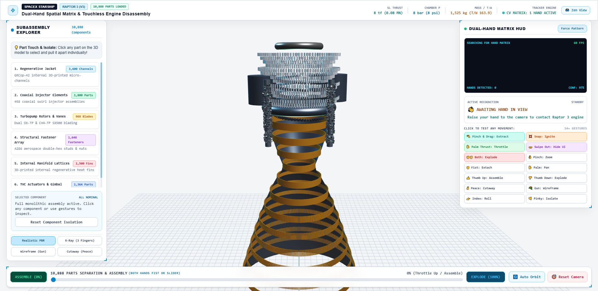
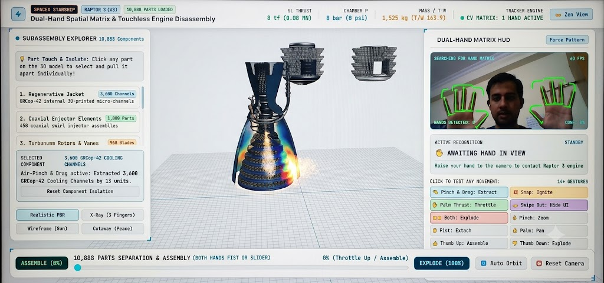

# 🚀 Project 08: SpaceX Starship Raptor 3 (V3) — Spatial CAD & Touchless Engine Disassembly

[](LICENSE)
[](https://threejs.org/)
[](https://developers.google.com/mediapipe)
[](https://www.spacex.com/vehicles/starship/)

> An Elon Musk / *Iron Man*-inspired touchless spatial computing CAD interface. Disassemble, inspect, throttle, and ignite SpaceX's next-generation **Raptor 3 (V3)** rocket engine using dual-hand computer vision gestures directly in your browser.



---

## 🌟 Overview & Engineering Highlights

This project transforms standard web browsers into an advanced holographic-style spatial workstation. Powered by **Three.js** and **Google MediaPipe Hands AI**, users can interact with all **10,888 procedural components** of the Raptor 3 engine through intuitive, natural hand gestures with zero physical controllers or specialized hardware.

### 🎯 Key Engineering Innovations:
1. **High-Contrast Video-Capture Ready Light Theme**:
   - Tuned specifically for recording demo videos and mobile phone screen captures without camera blowout or lens flares.
   - Clean architectural off-white palette (`#F4F5F7`), dual-tone blueprint grid (`#0284c7` / `#CBD5E1`), and crisp dark navy typography (`#0F172A`).
2. **21-Node Real-Time AI Hand Matrix**:
   - Live skeletal tracking with neon emerald overlays (`#00FF66` / `#10B981`) and dark drop-shadow outlines for maximum visibility in all lighting conditions.
   - Dual-hand interlock engine preventing false triggers while enabling complex bimanual choreography.
3. **10,888 Parts Exploded-View Kinematics**:
   - Subassemblies expand along mathematically accurate radial and longitudinal separation vectors.
   - Click or use gestures to extract subassemblies (e.g. *3,600 GRCop-42 Cooling Channels* or *968 Turbopump Blades*) for isolated inspection.
4. **Supersonic Plume & Combustion Physics**:
   - 1,400-particle supersonic exhaust plume with 4 dynamic Mach diamond shock cones.
   - Real-time thermal CFD emissive heatmaps on the nozzle throat and regenerative jacket.
   - Procedural Web Audio API synthesizer generating deep rocket rumble and torch igniter sparks.

---

## 🖐️ Dual-Hand Spatial Gesture Reference

| Gesture | Action | System Response |
| :--- | :--- | :--- |
| **Both Fists** (`✊✊`) | **Assemble / Explode Toggle** | Dual-hand interlock: toggles between **100% Full Separation** and **0% Full Re-Assembly** with debounced state transitions. |
| **Thumb Up** (`👍`) | **Incremental Assemble** | Smoothly draws separated parts together toward nominal 0% flight configuration. |
| **Thumb Down** (`👎`) | **Incremental Explode** | Smoothly expands the 10,888 components outward into exploded inspection view. |
| **Pinch** (`👌`) | **Dynamic Zoom** | Scales CAD camera distance in or out dynamically based on finger Euclidean distance. |
| **Open Palm** (`✋`) | **Orbit & Pan View** | Centers and orbits the 3D engine model following lateral hand movement across the video feed. |
| **Index Pointing** (`👉`) | **Roll Engine** | Spins the engine assembly clockwise around its vertical thrust axis. |
| **Pinch & Drag** (`🤏`) | **Air-Pinch & Extract** | Isolates the selected subassembly and pulls it outward along its local separation axis. |
| **The Snap** (`💥`) | **Ignition Sequence** | Thumb-to-middle snap initiates pre-burner torch igniters with dynamic flash and acoustic combustion crackle. |
| **Palm Thrust** (`✋` Forward) | **Engine Throttle Test** | Pushing an open palm forward toward the camera acts as a physical throttle (0–100%), driving plume velocity and Mach shock diamonds. |
| **Double Swipe Out** (`👐`) | **Zen Mode (Hide UI)** | Both hands swiping outward dismisses all sidebar cards for fullscreen engine viewing (swipe inward restores UI). |
| **Peace Sign** (`✌️`) | **Cutaway Mode** | Enables local clipping planes to reveal internal combustion chamber geometry. |
| **Gun Sign** (`🔫`) | **Wireframe Mode** | Toggles metallic surfaces into CAD wireframe vector lines. |
| **Three Fingers** (`🤟`) | **X-Ray Inspection** | Sets engine housing to semi-transparent glass to inspect internal regenerative lattices. |
| **Pinky Promise** (`🤙`) | **Isolate Jacket** | Instantly extracts the GRCop-42 cooling jacket from the core assembly. |

---

## 📊 Verified SpaceX Raptor 3 Flight Telemetry

The real-time telemetry HUD displays authentic specifications matching SpaceX's Raptor 3 (V3) flight engine:

| Metric | Flight Specification | Engineering Note |
| :--- | :--- | :--- |
| **Sea-Level Thrust** | **280 tf (2.75 MN)** | +50 tf increase over Raptor 1 |
| **Chamber Pressure** | **350 bar (5,076 psi)** | Highest operational chamber pressure in rocket history |
| **Engine Mass** | **1,525 kg** | Monolithic 3D printed integration (eliminating external heat shields) |
| **Thrust-to-Weight (T/W)** | **163.9** | World record for operational rocket engines |
| **Propellants** | **Sub-cooled Liquid CH4 & LOX** | Full-flow staged combustion cycle (FFSCC) |

---

## 🛠️ Project Structure

```
project_08_elon_inspiration/
├── index.html                           # Main entry point (Raptor 3 CAD & Gesture HUD)
├── raptor3_spatial_cad.html             # Standalone offline-ready HTML replica
├── README.md                            # Complete documentation & quickstart
├── PROMPT.md                            # Comprehensive engineering prompts & GitHub release notes
├── LICENSE                              # MIT Open Source License
├── package.json                         # NPM project metadata & scripts
├── start_server.bat                     # 1-Click Windows batch launcher
├── start_server.py                      # Python 3 CORS-enabled local HTTP server
├── assets/
│   └── images/
│       ├── raptor3_cad_light_theme.png  # Rendered CAD workstation preview
│       ├── dual_hand_matrix_hud.png     # Reference MediaPipe AI hand tracking HUD
│       ├── subassembly_explorer.png     # Component tree explorer
│       └── raptor3_dark_legacy.png      # Legacy dark mode reference
├── scripts/
│   ├── verify_app.js                    # Automated headless Chrome CDP tester
│   └── capture_demo.js                  # High-res screenshot / snapshot capture script
└── docs/
    ├── GESTURE_REFERENCE.md             # In-depth spatial kinematics manual
    ├── ARCHITECTURE.md                  # WebGL Three.js & MediaPipe pipeline documentation
    └── GITHUB_UPLOAD_GUIDE.md           # Step-by-step GitHub upload instructions
```

---

## 🚀 Quickstart & Setup

### Option 1: 1-Click Launch (Windows)
Double-click `start_server.bat`. It will launch a local Python server and automatically open `http://localhost:8080/index.html` in your default browser.

### Option 2: Python 3 Local Server
```bash
python start_server.py
```
Then open `http://localhost:8080/index.html`.

### Option 3: Direct Browser Launch
Open `index.html` or `raptor3_spatial_cad.html` directly in Google Chrome, Microsoft Edge, or Mozilla Firefox.

### Option 4: Automated Verification
Run automated headless Chrome testing via Chrome DevTools Protocol:
```bash
npm test
```

---

## 📸 Media Preview

| High-Contrast Light Mode CAD Viewport | Real-Time MediaPipe Hand HUD |
| :---: | :---: |
|  |  |

---

## 📄 License & Credits

- **Author**: **Mr. Elonikhil**
- **Portfolio Sequence**: **Project 08** (SpaceX & Advanced Aerospace Engineering Series)
- **License**: Licensed under the [MIT License](LICENSE).
- **Inspiration**: Elon Musk / *Iron Man* Spatial Holographic Engineering Workstation.

Feel free to fork, star ⭐, and build upon this spatial CAD architecture!
